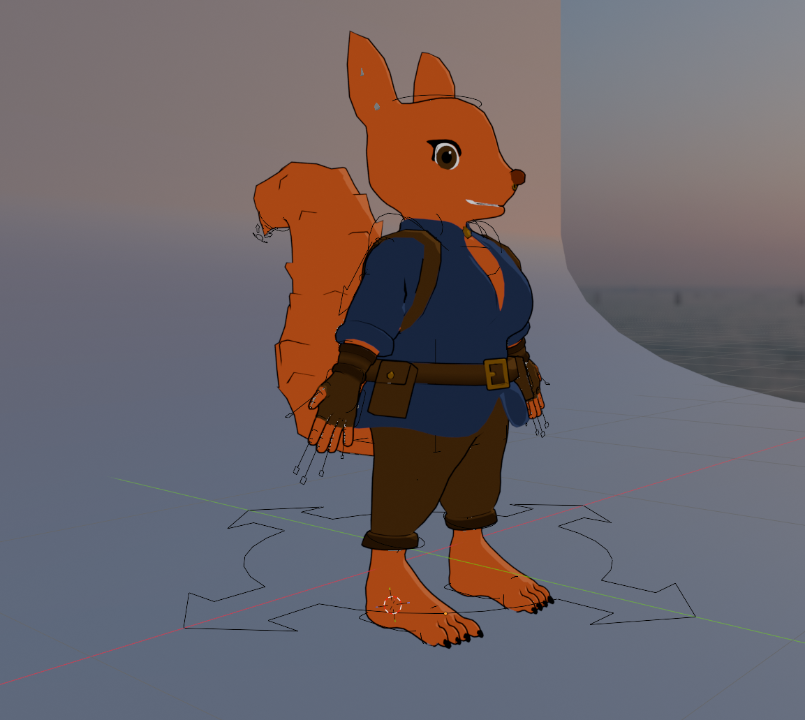
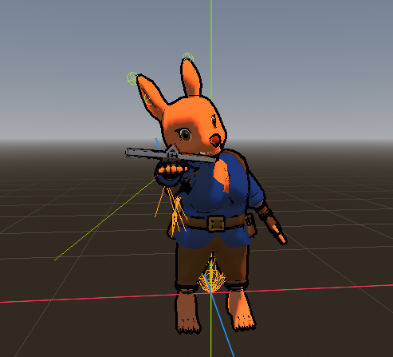

# Custom ~Squirrel Character Model

Custom character modeled/rigged/animated in Blender (5.2.0) with Godot (4.7.1) glb scene, including project files.

## Movement playground

Press **F6** with `scenes/playground.tscn` open, or **F5** to run the project. The scene includes jump steps, a ramp/drop, a low slide tunnel, a holdable wall, and a zipline. All obstacles are ordinary scene nodes that can be moved in the editor.

| Control | Action |
| --- | --- |
| WASD / arrow keys | Move relative to the camera |
| Mouse | Orbit the camera |
| Space | Jump; release early for a shorter jump |
| Right mouse button | Hold to blend crossbow aim while idle, running, jumping, or sliding |
| Shift / Ctrl | Slide; the capsule stays low until there is room to stand |
| Hold E in midair near the orange wall | Hold the wall; Space pushes off, releasing E drops |
| E near the cable start above the teal platform | Ride the zipline; Space jumps off early |
| R | Reset position |
| Esc / left click | Release / capture the mouse |

`scenes/character.tscn` is a reusable `CharacterBody3D` with its own controller, collision capsules, camera arm, and animation tree. Movement tuning is exposed in the root inspector. World geometry uses collision layer 1; the character uses layer 2. Additional holdable walls need the `holdable_wall` group. Additional ziplines use `scripts/zipline.gd`, the `ziplines` group, and `Start`/`End` markers at cable height; `hang_offset` sets the character's distance below the cable.

The animation graph is built by `scripts/character_animation.gd` at runtime, leaving the imported GLB clips unchanged:

- `basis` supplies the stationary pose; `run` follows movement speed.
- `jumpStart`, `falling`, and `jumpLand` follow takeoff, airborne motion, and ground contact.
- `sliding`, `wallHolding`, and `zipping` correspond to their movement modes.
- `crossbow_aim` fades over locomotion through a filtered `AnimationNodeBlend2`. Its mask follows the `ORG-shoulder.R` subtree and the neck/head subtrees (`DEF-spine.004`, `neck`, `head`). Hips, legs, torso, tail, and left arm retain the movement animation. Wall holding and zipping fade aim out so their hand poses remain available.

The graph uses [Godot's animation track filtering](https://docs.godotengine.org/en/stable/tutorials/animation/animation_tree.html#blend2-blend3). The HUD shows the current movement clip and aim weight.

Run the movement and bone-isolation checks with:

```powershell
godot_console --headless --path . --fixed-fps 60 --script tests/playground_test.gd
```

For rendered verification images in `.godot/`, omit `--headless` and append `-- --screenshots`.

## Rigged Blender Model (viewport)



## Godot Character Scene (run cycle v1)



## todo

- model fixes
  - [ ] finish decoupling bottom of shoulder belt from arm movements
  - [x] make bone weights uniform across the pouches(double checking the pouch buttons)
  - [x] add extra jiggle bones
- [x] implement pose library
- blender animations
  - [x] idle
  - [ ] walk
  - [x] run
  - [x] basic jump (start/cycle/land)
  - [ ] backflip
  - [ ] slide
  - [ ] rail-grind
- [ ] corresponding sound fx
- fur
  - [ ] polish tufts in Blender
  - [ ] try adding smaller hair cards and overlaying textures
    - [ ] scripting tufts, ear, and tail for wind sway
- [ ] polish godot outline shader
- [ ] shape key facial animations
- [x] basic godot character controller for testing
- [ ] evaluate bone export types for data/profiler overhead
  - [ ] clean keyframes

## External Resources

Codernunk 3D Character Guide ([YT link](https://youtu.be/dd6G2S6MQ6U))

## Vibe character toon material

Codernunk pipeline is a bit broken from the apparent disappearance of the github repo for hijacking the vertex color channels to control character outline settings from Blender to Godot, so the material was vibed out as a Godot shader material with a palette texture and outline pass.  Here is the llm description of the material:

`toon_material.tres` combines two passes:

- `toon.gdshader` draws the palette texture with a hard light/shadow split.
- `outline.gdshader` draws expanded back faces as a screen-space outline.

The material is already assigned to surface 0 of `anime_squirrel_test.tscn`.
When the GLB is re-exported from Blender, keep the imported mesh node named `model`,
or reassign `toon_material.tres` as that mesh's **Material Override**.

Useful material parameters:

- **Shadow Tint** controls the cool color on faces turned away from a light.
- **Shadow Threshold** moves the light/shadow boundary.
- **Shadow Softness** changes the edge from crisp to slightly feathered.
- **Ambient Strength** keeps the character readable outside direct light.
- In **Next Pass**, **Outline Width** is measured in screen pixels and
  **Outline Color** controls the ink color.
